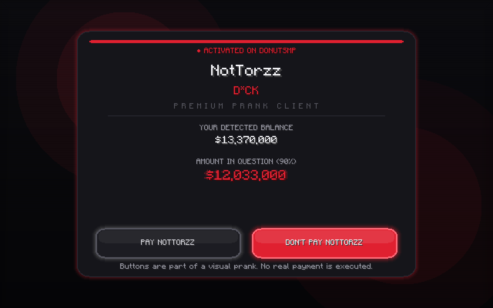
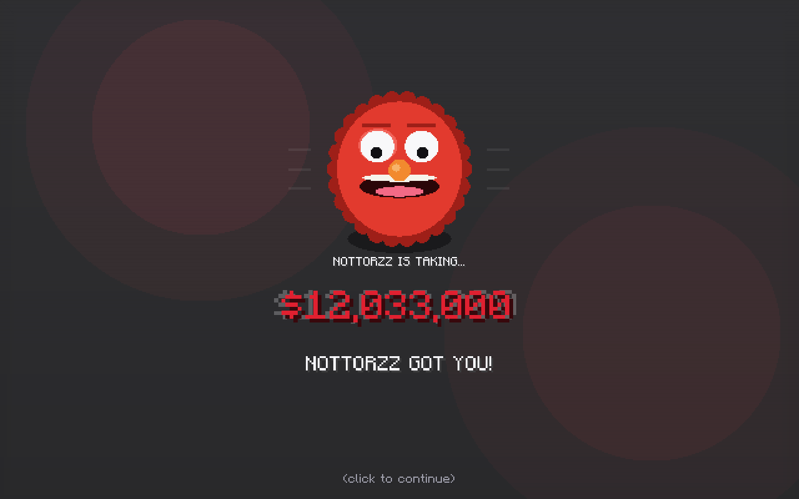
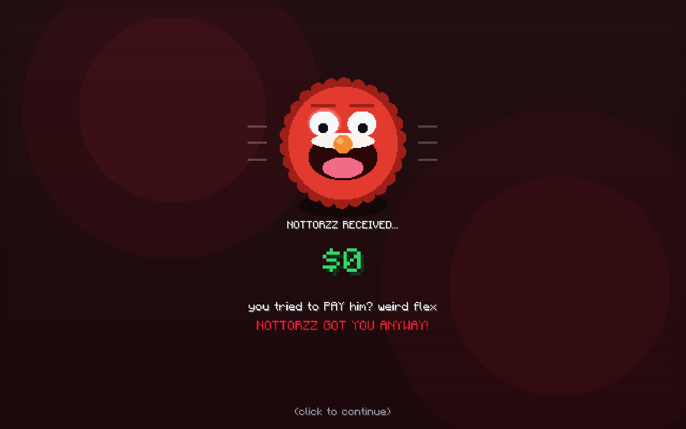
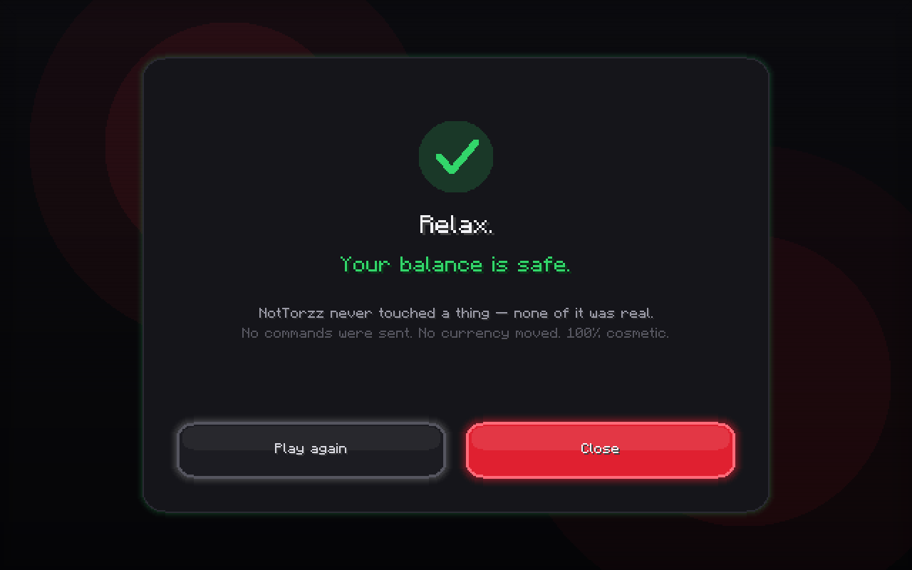

# NotTorzz D\*CK

A **100% cosmetic** DonutSMP prank mod for **Minecraft 1.21.11+ (Fabric)**.

When you join DonutSMP it throws up a slick, animated "premium client" interface,
plays a dramatic *"pay NotTorzz"* gag — fake numbers, a countdown, flashing lights
and a laughing mascot — and then reveals the punchline: **your balance was never
touched.**

> ### ⚠️ Read this first — it's just a joke
> This mod **does not send any command, does not run `/pay`, does not move a single
> coin, and does not read or transmit any personal data.** Every number on screen is
> for show. There is no code path anywhere in this project that can transfer currency.
> It is a visual bit, nothing more. The on-screen disclaimer says the same thing, and
> the gag always ends with **"Relax. Your balance is safe."**

---

## Screenshots

| Menu (branding + fake balance + the two buttons) | The reveal ("NOTTORZZ GOT YOU!") |
|---|---|
|  |  |

| "You tried to PAY him?" variant | The honest ending |
|---|---|
|  |  |

*(These are real frames captured from Minecraft 1.21.11 running the mod — see
[Build & test results](#build--test-results).)*

---

## Features

### 1. Join detection
* Detects when you connect to **DonutSMP** by matching the server address against a
  configurable substring (default `donutsmp`).
* A moment after joining it fires the prank:
  * an animated on-screen notification — **“NotTorzz D\*CK has activated.”**
  * a funny chime, and
  * the custom animated interface opens automatically.
* Reconnecting re-arms the gag, so it triggers again on your next join.

### 2. Balance display (read-only, best effort)
* Reads your **publicly displayed** balance from text the game has already received —
  the **sidebar scoreboard** and **chat/system messages** that mention a balance.
* Parses amounts in whatever form a server prints them: `$1,234,567`, `12.5k`,
  `3.2m`, plain numbers, etc.
* Calculates **90%** of it (configurable) and shows that as the dramatic "amount in
  question."
* If no balance is visible it falls back to a configurable **demo** number and labels
  it as such. **Nothing is ever requested from the server** — it only looks at what's
  already on your screen.

### 3. The two buttons
Two large, animated buttons:

* **`PAY NOTTORZZ`** — triggers a comedic anticlimax: NotTorzz receives **$0**
  ("you tried to *pay* him? weird flex") … and still gets you anyway.
* **`DON'T PAY NOTTORZZ`** — triggers the full dramatic reveal with the calculated
  fake amount.

Right under them, a small but **clearly readable** disclaimer:

> *Buttons are part of a visual prank. No real payment is executed.*

**Neither button sends a command or moves any currency.** They only change which
animation plays.

### 4. The big reveal
After a button is pressed:
* a dramatic **3 · 2 · 1** countdown ("processing payment…"),
* the amount in **HUGE** text,
* a **laughing mascot** animation,
* **flashing red/white** effects,
* funny cackle sounds, and
* **“NOTTORZZ GOT YOU!”**

…then it drops the act:

> **Relax. Your balance is safe.**
> *NotTorzz never touched a thing — none of it was real.*
> *No commands were sent. No currency moved. 100% cosmetic.*

### 5. Reopen keybind
A configurable keybind (listed under **Options → Controls → NotTorzz D\*CK /
Miscellaneous**) reopens the interface any time. It's **unbound by default** so it
can never clash with another mod's keys — bind it to whatever you like.

---

## Design

* Dark, near-black background with drifting red glow, subtle scanlines and a vignette.
* **Red + white** accent palette, white primary text.
* Rounded buttons with hover "pop", glow and gloss.
* Smooth, time-based animations (entrance, countdown, mascot bounce, reveal shake).
* Premium "client-style" layout inspired by modern utility-client menus.
* **Zero bundled textures or audio** — every shape is drawn procedurally and every
  sound reuses a vanilla sound event, so the whole mod is a ~37 KB jar and stays
  lightweight.

### About the "Elmo" laugh
The brief asked for a laughing Elmo. Elmo is a trademarked, copyrighted character, so
this mod ships an **original** red cartoon mascot drawn from scratch (circles and
ellipses, no imported art). It fills the exact same "something is cackling at you"
comedic role without using anyone else's intellectual property.

---

## Requirements

| | |
|---|---|
| Minecraft | **1.21.11** or newer in the 1.21.11 line |
| Mod loader | **Fabric Loader** 0.20.1+ |
| Dependency | **Fabric API** (matching your MC version) |
| Java | **21+** (Minecraft 1.21.11 itself requires a modern JVM) |

It is a **client-side** mod. You do **not** install it on a server, and the server
can't see it.

---

## Installation (players)

1. Install [Fabric Loader](https://fabricmc.net/use/) for your Minecraft version.
2. Download **[Fabric API](https://modrinth.com/mod/fabric-api)** for the same version
   and drop it in your `mods/` folder.
3. Drop **`nottorzz-dck-1.0.0.jar`** into the same `mods/` folder.
4. Launch Minecraft with the Fabric profile, join DonutSMP, and enjoy the bit.
5. *(Optional)* Bind the reopen key in **Options → Controls**.

---

## Configuration

A config file is created at `.minecraft/config/nottorzz_dck.json` on first run:

| Option | Default | Meaning |
|---|---|---|
| `enabled` | `true` | Master on/off switch for the whole prank. |
| `autoOpenOnJoin` | `true` | Auto-open the interface shortly after joining DonutSMP. |
| `playSounds` | `true` | Play the comedy sound effects. |
| `flashingEffects` | `true` | **Accessibility:** set `false` to disable all flashing (for photosensitive users). The prank still works, just without the strobe. |
| `payPercent` | `0.90` | Fraction of the detected balance shown as the fake amount. |
| `serverMatch` | `"donutsmp"` | Case-insensitive substring matched against the server address to detect DonutSMP. |
| `demoBalance` | `1000000` | Fallback amount shown when no real balance is detected. |
| `activationDelayTicks` | `40` | Ticks to wait after joining before activating (20 = 1 second). |

---

## ♿ Accessibility & safety notes

* The reveal includes a **flashing red/white** effect. If you are photosensitive, set
  `flashingEffects` to `false` in the config (or turn the whole thing off with
  `enabled: false`). The frequency is kept moderate and the overlay opacity low, but
  the toggle is there so you never have to see it.
* The mod never pauses your game (`shouldPause` is false) and never blocks input to
  the server in a way that could get you in trouble — it draws an overlay and reads
  text, nothing else.

---

## Building from source

Everything needed is pinned and verified against live Mojang/Fabric metadata.

```bash
# Requires a Java 25 JDK on PATH / JAVA_HOME (the 1.21.11 Fabric Loom toolchain needs it).
./gradlew build
```

The finished mod is written to `build/libs/nottorzz-dck-1.0.0.jar`
(the `-sources.jar` next to it is just source for IDEs).

**Pinned toolchain** (`gradle.properties`):

| | |
|---|---|
| Minecraft | `1.21.11` |
| Yarn mappings | `1.21.11+build.6` |
| Fabric Loader | `0.20.1` |
| Fabric API | `0.141.6+1.21.11` |
| Fabric Loom | `1.19.4` |
| Gradle | `9.9.1` (via the included wrapper) |

> **Why Java 25?** Fabric Loom 1.19.4 (the build plugin for the 1.21.11 era) runs on a
> Java 25 JVM. The mod's own bytecode is still compiled to Java 21 (`options.release =
> 21`) for maximum runtime compatibility.

---

## Project structure

```
src/main/java/net/nottorzz/dck/
├── NotTorzzDck.java                     # shared constants + logger
└── client/
    ├── NotTorzzDckClient.java           # entrypoint: join detection, keybind, wiring
    ├── BalanceReader.java               # read-only chat + scoreboard balance scanning
    ├── Money.java                       # tolerant currency parse/format
    ├── DevPreview.java                  # screenshot harness (dev-only, env-gated)
    ├── config/PrankConfig.java          # JSON config
    ├── sound/PrankSounds.java           # vanilla-sound comedy SFX
    └── gui/
        ├── PrankScreen.java             # the animated MENU→COUNTDOWN→REVEAL→SAFE screen
        ├── PrankButton.java             # animated custom button
        └── render/
            ├── Colors.java              # palette + ARGB helpers
            ├── Draw.java                # rounded rects, gradients, glow, big text
            ├── Easing.java              # easing curves
            └── Mascot.java              # the procedural laughing mascot
```

### Compatibility with other mods
* Purely **client-side**, **no mixins**, no access wideners — it only uses public
  Fabric API events (`ClientPlayConnectionEvents`, `ClientTickEvents`,
  `ClientReceiveMessageEvents`) and reads vanilla state.
* It registers one unbound keybind and draws its own screen. It does not touch other
  mods' classes, networking, world state or rendering, so it won't interfere with
  them.

---

## Build & test results

See [`BUILD_AND_TEST.md`](BUILD_AND_TEST.md) for the full compile log summary, the
headless-client load test, and how the screenshots were captured.

---

## License

MIT — see [`LICENSE`](LICENSE). This is a parody/joke project. "DonutSMP" and any
other names belong to their respective owners; this mod is unofficial and not
affiliated with or endorsed by them.
